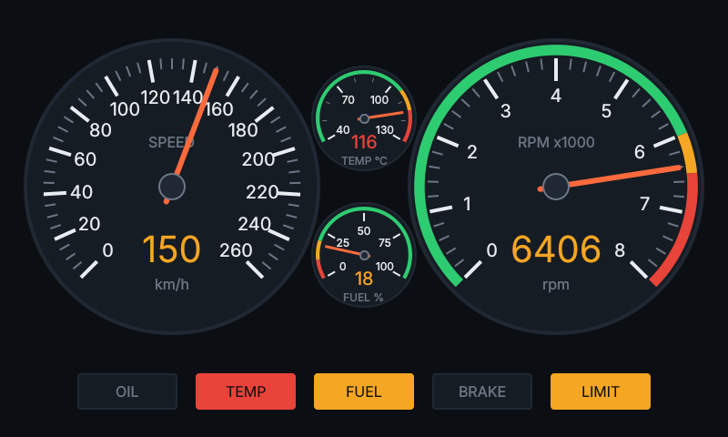
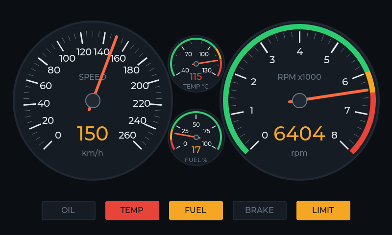
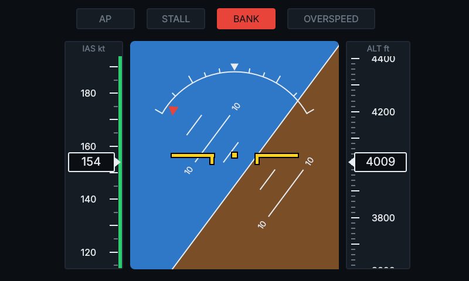
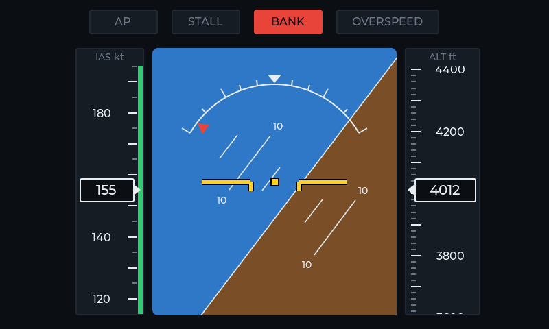

# IDEV Instrument Kit

Gauges, tapes, an artificial horizon and warning lights with **one data model for two
rendering engines**: Qt Quick (Qt 6) and LVGL 9 (C, for ESP32 / STM32).

Describe an instrument once in `spec/instruments.json` — range, unit, green/amber/red zones,
alert thresholds with hysteresis, damping — and get the same behaviour on a Linux board with a
GPU and on a microcontroller.

*Français : voir [README.fr.md](README.fr.md).*

| Qt Quick (QML) | LVGL 9 (C) |
|---|---|
|  |  |
|  |  |

*Same scenario time in both columns (car t = 26 s, PFD t = 19.5 s). Qt captures use the Qt Quick
software renderer, offscreen; LVGL captures use LVGL's software renderer into a memory buffer.*

> **Not for real flight or vehicle use.** This is a prototyping and demonstration kit. It is not
> certified (DO-178C, ISO 26262 or otherwise) and must not be used as a primary instrument.

## Status: v0.1

| Component | Qt Quick | LVGL 9 |
|---|---|---|
| `RoundGauge` — needle dial with coloured zones | yes | yes |
| `LinearTape` — vertical moving scale (speed, altitude) | yes | yes |
| `AttitudeIndicator` — artificial horizon, roll / pitch | yes | yes |
| `Annunciator` — normal / caution / warning light, flashing, acknowledge | yes | yes |
| Demo: car cluster (speed, RPM, coolant, fuel, warning lights) | yes | yes |
| Demo: primary flight display (horizon, speed and altitude tapes, alerts) | yes | yes |

Measured so far on a PC only (no target hardware yet) — see [docs/VERIFICATION.md](docs/VERIFICATION.md).

## Layout

```
spec/instruments.json   the data model (single source of truth)
tools/                  gen_instruments.py: JSON -> C table, validated at build time
core/                   idev_core: C99, no GUI. Damping, alerts, zones, formatting, blink, demo scenarios
lvgl/                   LVGL 9 widgets, demos, headless PNG host, optional SDL2 simulator
qml/IdevInstruments/    Qt 6 QML module (C++ types + declarative QML components)
qml/demos/              car-cluster, cockpit-pfd
docs/                   SPEC.md, API.md, ADR, VERIFICATION.md, screenshots/
```

## Build

Requirements: CMake 3.21+, a C99/C++17 compiler, Python 3.8+.

### LVGL (PC, headless)

```sh
git clone --depth 1 -b v9.2.2 https://github.com/lvgl/lvgl.git third_party/lvgl
cmake --preset lvgl-headless          # needs libpng
cmake --build --preset lvgl-headless
ctest --preset lvgl-headless
build/lvgl/lvgl/idev_lvgl_headless --demo car --time 26 --png car.png
build/lvgl/lvgl/idev_lvgl_headless --demo pfd --time 19.5 --png pfd.png
build/lvgl/lvgl/idev_lvgl_headless --memreport
```

Interactive simulator (needs SDL2 development files): `cmake --preset lvgl-sdl`, then
`build/lvgl-sdl/lvgl/idev_lvgl_sdl car` or `... pfd`.

On a device, add `lvgl/src/*.c`, `core/src/*.c` and the generated table to your firmware,
create widgets with `idev_round_gauge_create(parent, "car.rpm")` and push samples with
`idev_instrument_widget_set_value()`. ESP32-S3 tips (esp_lvgl_port): draw buffer of 10–25 %
of the screen in internal SRAM, double buffering, `CONFIG_COMPILER_OPTIMIZATION_PERF`,
240 MHz CPU, QIO flash at 120 MHz, `CONFIG_LV_DEF_REFR_PERIOD=10`.

### Qt Quick (Qt 6.8 or later)

```sh
cmake --preset qt -DCMAKE_PREFIX_PATH=/path/to/Qt/6.8.x/gcc_64
cmake --build --preset qt
ctest --preset qt
build/qt/qml/demos/car-cluster/idev_qt_car_cluster
build/qt/qml/demos/cockpit-pfd/idev_qt_cockpit_pfd
# screenshot without a display:
QT_QPA_PLATFORM=offscreen QT_QUICK_BACKEND=software \
  build/qt/qml/demos/car-cluster/idev_qt_car_cluster --time 26 --grab car.png
```

Uses the Qt modules Core, Gui, Qml, Quick and Quick Shapes only (all LGPLv3 / commercial; no GPL-only module).

### Using it in QML

```qml
import IdevInstruments

Instrument { id: rpm; configId: "car.rpm"; value: vehicle.rpm }   // NaN = sensor lost
RoundGauge { width: 330; height: 330; instrument: rpm }
Annunciator { configId: "car.ann.temp"; level: coolant.alertLevel }
```

Full reference: [docs/API.md](docs/API.md). Scope, acceptance criteria and roadmap:
[docs/SPEC.md](docs/SPEC.md).

## Licences

- **This kit**: MIT — see [LICENSE](LICENSE).
- **LVGL**: MIT (not included in this repository; cloned separately into `third_party/lvgl`).
- **Qt**: available under LGPLv3 (or GPL for some modules) and under commercial licences from
  The Qt Company. The kit only uses LGPLv3 modules; if you ship a product with Qt under LGPLv3,
  you must meet its obligations (notably allowing users to relink or replace the Qt
  libraries). Check your own licence situation, or buy a commercial Qt licence.
- Fonts: the LVGL demos use the Montserrat fonts bundled with LVGL (SIL OFL 1.1).

Made by IDEV (Belgium) — embedded HMI prototypes in Qt and LVGL.
